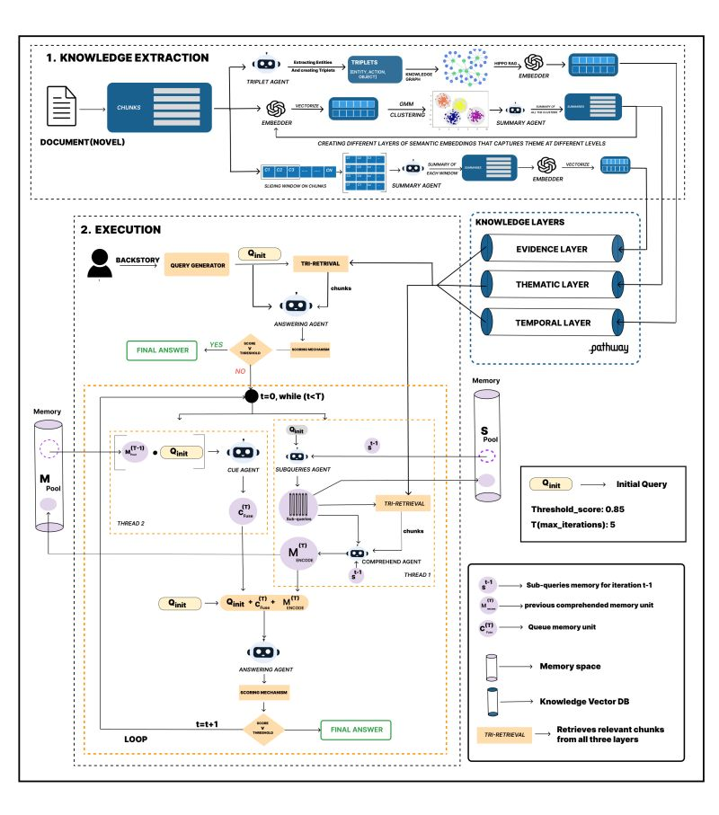
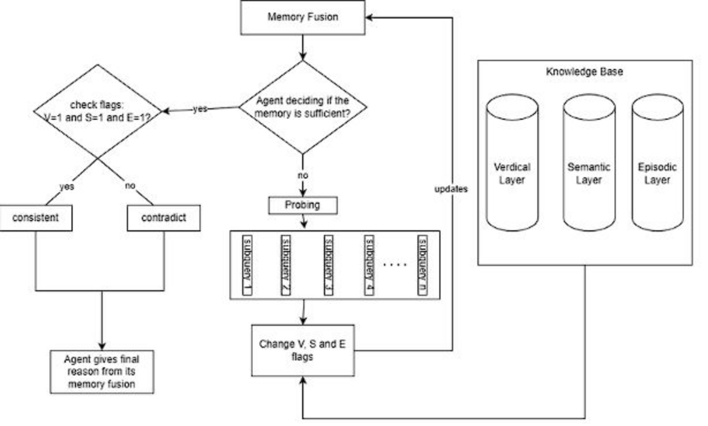

# Global-Context Narrative Reasoning for LLMs

**First Runner-Up, Kharagpur Data Science Hackathon 6.0 (KDSH 2026), IIT Kharagpur.** Team Unlabeled, VIT Vellore. Track A: Using LLMs and Generative AI.

LLMs read a passage well but struggle to keep a consistent picture of a whole story. This project checks whether a claim about a character holds up against an entire novel.

## The task

Given a full-length novel and a hypothetical backstory for one of its characters, decide whether the backstory is **consistent** with the narrative or **contradicts** it, and give a short reason grounded in the text.

Three things make this hard:

- **Scattered evidence.** A backstory can agree with some passages and be contradicted by a scene hundreds of pages away.
- **Characters change.** A backstory may fit who a character is early on and contradict who they become.
- **Timeline and causality.** A backstory may rely on knowledge or events that only become possible later in the story.

The novels are also far too long for a model's context window; *The Count of Monte Cristo* is about 460,000 words.

## What we tried first

| Approach | What happened |
|---|---|
| Give the whole novel to an LLM | The novel exceeds the context window; reasoning was shallow and sensitive to prompt wording. About 60% accuracy on the provided `train.csv`. |
| Standard RAG (embed, retrieve once, answer) | Single-pass retrieval discards evidence after one step and misses long-range and temporal contradictions. |

## Architecture



### 1. Knowledge extraction: three memory layers

| Layer | What it holds | How it is built |
|---|---|---|
| **Veridical (evidence)** | Explicit facts from the novel | Subject-predicate-object triples organised as a knowledge graph, for multi-hop factual reasoning |
| **Semantic (thematic)** | Themes, traits and motivations | Embeddings clustered with Gaussian mixture models, then recursively summarised into a hierarchy |
| **Episodic (temporal)** | Plot progression and cause-and-effect chains | Sliding-window summaries over chunks, kept in narrative order |

### 2. Iterative reasoning

1. The backstory is turned into an initial query.
2. **Tri-retrieval** pulls relevant material from all three layers.
3. A central agent judges whether the gathered memory is sufficient to decide.
4. If not, it generates probing queries, splits them into focused sub-questions, retrieves again, and **fuses** the new findings into a shared memory pool.
5. The loop repeats for up to 5 iterations, then the system outputs a label and a one-to-two-line reason.

The original retrieval-architecture diagram from the final presentation:



*Drawn by Arya Mulay.*

## Results

As reported in the team's final presentation:

| Metric | Value |
|---|---|
| Accuracy | 90.0% |
| Precision | 93.75% |
| Recall | 90.0% |
| F1-score | 91.8% |

## Built on ComoRAG

This project adapts **[ComoRAG](https://github.com/EternityJune25/ComoRAG)**, an open-source framework for stateful long-narrative reasoning, which builds on ideas from HippoRAG and RAPTOR. The memory layers, tri-retrieval and probing loop come from ComoRAG. Our work was adapting it to the backstory-consistency task: reformulating the problem, rewriting the prompts for evidence-focused probing and consistency reasoning, indexing the hackathon novels, and wiring the pipeline to the competition's input and output format.

ComoRAG is released under the MIT licence; see [`LICENSE-ComoRAG`](LICENSE-ComoRAG).

## Team

Built by Team Unlabeled, a team of four from VIT Vellore.

### My contributions (Arya Mulay)

- Co-developed the reasoning and evidence-probing logic with one teammate.
- Designed the retrieval architecture and drew the original architecture diagram.
- Co-wrote the round-one technical report and co-built the final presentation.

## Documents

- [`docs/KDSH_2026_presentation.pdf`](docs/KDSH_2026_presentation.pdf): the final presentation.
- [`docs/KDSH_2026_report.pdf`](docs/KDSH_2026_report.pdf): the round-one technical report.

## Running it

```bash
python3 -m venv venv && source venv/bin/activate
pip install -r requirements.txt
# put your API key and base URL in a .env file (see env.example)
# place test.csv in the repository root
python3 main.py
```

`results.csv` is written to the repository root with an `id`, `label` and `reason` for each row.

## Limitations

- Embedding similarity can miss subtle causal cues, and chunking can split long dependencies.
- Implicit motivations remain hard to infer, and the iteration budget limits exhaustive reasoning.
- Embeddings are precomputed for two novels only; a new novel has to be indexed first.
- The submitted entry point (`main.py`) sends each query to the team's hosted inference endpoint rather than running the full pipeline locally.

## About this repository

This is my copy of the team's January 2026 submission, assembled in October 2026 with the documentation, diagrams and ComoRAG attribution added.
